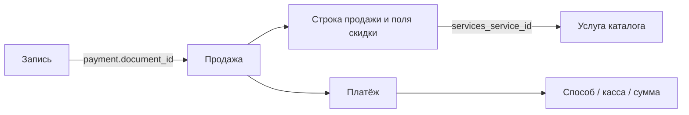

# DIKIDI: исследование протокола, этап 12.1

Базовое исследование: 27.10.2026. Повторная проверка каталога, графиков и окон: 28.10.2026. Основание: согласованный [Stage 12.txt](Stage%2012.txt).

Статус: базовый исследовательский протокол зафиксирован 27.10.2026 по поручению пользователя. Подэтап 12.1 завершён по аналитическому результату: подтверждённое чтение, каталог запросов, семантика сущностей, ограничения и обязательные проверки перед реализацией. Непроверенные операции и сценарии явно перечислены ниже; A/W не объявляются выполненными целиком. 28.10.2026 в [семантике](CRM_SEMANTICS.md) и [технических контрактах](CRM_CONTRACTS.md) учтены восемь согласованных замечаний двух ревью, 12.2 завершён как спецификация. В согласованном 12.3 реализован Java-адаптер авторизации, проверки проекта и чтения мастеров вместе с REST/UI настройки и четырьмя CRM-таблицами; остальные CRM-проекции и команды ещё не реализованы.

## Зафиксированная часть протокола

Это результат исследования 12.1 и основание зафиксированной спецификации 12.2. Закрытие исследования означает фиксацию фактов, ограничений и обязательных проверок; оно не означает готовность production-адаптера или подтверждение изменяющих операций.

| Область | Зафиксированный результат | Граница |
|---|---|---|
| Вход и проект | Вход с CSRF двух шагов и разрешённым согласием; авторизованное чтение на `dikidi.ru` | Истечение сессии, отзыв и изоляция нескольких подключений ещё требуют испытаний |
| Каталог | Повторно получены два мастера, три уникальные услуги и четыре предложения; одна услуга связана с обоими мастерами | У общей услуги цена/длительность одинаковые; разные значения одной услуги у разных мастеров и варианты одной пары не проверены |
| Клиент и визиты | Карточка клиента, общий журнал и HTML истории вернули два визита с совпадающими ID | Фильтр клиента R05 не подтверждён; произвольная прошлая история и полнота страниц остаются открытыми |
| Расписание и окна | Получены 11 смен двух мастеров за 28.10–30.11; подтверждён отдельный R17 с явным master_id и различие графика/слотов | IANA timezone, непустые перерывы/ресурсы, ночные смены и положительный многосервисный сценарий ещё не установлены |
| Продажа и скидка | Через ID документа визита читаются продажа и её строка: цена 5 000, скидка 30% / 1 500, итог 3 500 RUB | Наблюдались одна строка и один документ; общая кардинальность связей не устанавливается по одному примеру |
| Платёж | У продажи отдельный список операций и отдельная карточка платежа; получены 3 500 RUB наличными через кассу | Смешанная/частичная оплата, возвраты и другие способы не испытаны |
| Чаты | Список, непрочитанное, участники и текстовая история читаются на `chat.dikidi.ru` | Коннектор, отправка, отметки, вложения и поток обновлений относятся к 13 и не проверены |
| Создание/перенос/отмена | Найдены запросы-кандидаты и их риски | Только S: до проверок W соответствующие команды не объявляются поддержанными |

Связи наблюдавшихся сущностей:

У продажи, строки продажи, услуги каталога и платежа отдельные ID. Разные `client_map_id` двух визитов одного клиента не являются стабильным client ID. Пользователь чата и карточка CRM также имеют разные ID; автор онлайн-записи может совпадать с участником чата, но это определяет автора действия и не доказывает идентичность получателя услуги.

Базовый объём ClientBus остаётся лёгкой CRM. Чтение скидки/оплаты конкретного визита не означает проведение платежей, редактирование продаж, внедрение склада или финансового учёта. Интерфейсы, DTO и схема зафиксированы в [CRM_CONTRACTS.md](CRM_CONTRACTS.md) по результатам 12.2; реализация ещё не начата.

## Границы и доказательства

Исследуется CRM: подключение, проекты, клиенты, мастера, услуги, графики и визиты. По отдельному запросу пользователя также выполнено чтение чатов для проверки доступных сущностей; результаты приведены ниже. Реализация чатов, `DikidiChannelConnector`, выделение каналов и связывание CRM с `ChannelAccount` относятся к этапу 13.

Уровни доказательности:

| Уровень | Значение |
|---|---|
| S | Метод/формат прочитан в зафиксированном исходнике SDK или веб-клиента; живой вызов не подразумевается |
| P | Наблюдение публичного сайта без авторизации |
| A | Проверка чтения на авторизованном проекте пользователя |
| W | Проверка изменения и результата на согласованных тестовых данных |

S не подтверждает текущую работоспособность, полноту ответа, доступность на конкретном тарифе или права аккаунта. Проверки A ниже относятся к одному выбранному проекту и наблюдавшемуся небольшому набору данных; проверок W нет. Чужие integration tests прочитаны, но не запускались; их наличие не считается нашей живой проверкой.

В доступном браузере открыта публичная главная страница `https://dikidi.ru/` (P). Авторизованного проекта при начале проверки не было. Позднее пользователь предоставил данные для разовой проверки входа; они использованы только в памяти локального процесса и не записывались в файлы проекта. В отчёте нет паролей, cookies и данных клиентов. Запросы резервирования, сохранения, переноса и удаления не выполнялись.

## Зафиксированные источники

Ссылки закреплены на commit, чтобы обновление ветки не меняло доказательства.

| Источник | Commit | Что исследовано |
|---|---|---|
| [ixtora/dikidi-api](https://github.com/ixtora/dikidi-api/tree/95d61799ead7a60541e95c1e5a66db9aa5a4d443) | `95d61799ead7a60541e95c1e5a66db9aa5a4d443` | Авторизация и первая страница списка записей |
| [asbevz/dikidi-api](https://github.com/asbevz/dikidi-api/tree/d8a054341893533e4f3fce90101e2cd8ad180352) | `d8a054341893533e4f3fce90101e2cd8ad180352` | Клиент HTTP, журнал, поиск клиентов и integration tests |
| [Igor20-1/dikidi-api-client](https://github.com/Igor20-1/dikidi-api-client/tree/bd61a6d843eb66361478459f1772a699327a9edb) | `bd61a6d843eb66361478459f1772a699327a9edb` | Авторизация, transport/guards, каталоги, клиенты, записи, парсеры и расчёт окон |
| [SemyonBurlak/dikidi-api](https://github.com/SemyonBurlak/dikidi-api/tree/d3cf8ff347a899c1cf18b8c61f59a8ef7c85c7e2) | `d3cf8ff347a899c1cf18b8c61f59a8ef7c85c7e2` | Java-запросы каталога и доступного времени клиентской формы записи |
| [Alex221291/dikidi-booking-api](https://github.com/Alex221291/dikidi-booking-api/tree/ad8fa18ac84df52a31fa74ca3b3641ab652edcb7) | `ad8fa18ac84df52a31fa74ca3b3641ab652edcb7` | Дополнительный код клиентского бронирования; часть DIKIDI-сценария закомментирована |

Основной источник для кабинета владельца — Igor20-1; asbevz даёт независимое описание ряда запросов. Их хосты и локали расходятся, поэтому это кандидаты для проверки, а не перечень готовых гарантированных endpoint.

Для чтения продаж/платежей и отдельных полей состояния дополнительно изучен актуальный веб-клиент DIKIDI. Это первичный источник текущей формы кабинета, без запуска его JavaScript с реальной сессией. SHA-256 рассчитан по UTF-8 содержимому HTTP-ответа; сами файлы и персональные ответы в репозиторий не копировались. Динамические URL ниже могут обновляться, поэтому зафиксированы отпечатки наблюдавшейся версии.

| Файл | Байт | SHA-256 | Last-Modified |
|---|---|---|---|
| [sales.js](https://dikidi.ru/assets/js/sales.js) | 207836 | `73d63d69d4d3e06cb59c1b07b3b6c6b2bb6b48a909c5436697a8087893f61cf0` | Tue, 06 Oct 2026 07:34:07 GMT |
| [journal-module2.js](https://dikidi.ru/assets/js/journal-module2.js) | 347572 | `8e82765110a1d54e9ec369c00f8272481b270517c31e8469c94413d6bbabbb8d` | Mon, 26 Oct 2026 13:04:51 GMT |
| [owner.js](https://dikidi.ru/assets/js/owner.js) | 389455 | `37e0ab084af9d53b5c93b28bfa006c78c8ed81dbd98a2f77dfaae3b406b5294b` | Wed, 07 Oct 2026 07:56:17 GMT |
| [backend.js](https://dikidi.ru/assets/global/js/backend.js) | 97738 | `6a15e7513a02ec27f65498a721b4e0c4ffe3d8c393b0fbfe854eeb148b9e6c96` | Thu, 16 Jul 2026 12:19:18 GMT |
| [newrecord.js](https://dikidi.ru/assets/js/newrecord.js?v=2465496188), проверен 28.10 | 84617 | `eb45541ccd1c815a13aa8213aefce2c5284249e5ccb64f8cb055fdd1588becc8` | Не зафиксирован |

## Авторизация и проект

В [простом клиенте asbevz](https://github.com/asbevz/dikidi-api/blob/d8a054341893533e4f3fce90101e2cd8ad180352/dikidi_api/client.py) вход отправляет `number/password` на `auth.dikidi.ru`, после чего открывает журнал выбранного `company`. Наличие callback успешного входа используется как признак авторизации.

[AuthFlow Igor20-1](https://github.com/Igor20-1/dikidi-api-client/blob/bd61a6d843eb66361478459f1772a699327a9edb/dikidi/auth/flow.py) описывает более длинную последовательность (S):

| Шаг | Запрос | Назначение |
|---|---|---|
| 1 | GET `dikidi.ru/ru/` | Получить исходный CSRF для входа |
| 2 | POST `auth.dikidi.ru/ajax/check/auth/` | Проверить номер; возможный второй CSRF |
| 3 | POST `auth.dikidi.ru/ajax/user/auth/` | Передать номер, пароль и CSRF; проверить callback |
| 4 | GET `dikidi.net/ru/owner/journal/?company={project}` | Инициализировать контекст проекта |

Код переносит отдельные cookies между доменами; такое поведение нельзя принимать как обязательную часть актуального протокола без наблюдения реальных переходов. Необходимо установить канонический owner-host, фактический scope cookies, срок сессии и условия повторного входа.

В исследованных основных клиентах `company_id` передаётся в конфигурации. Текущий способ перечисления доступных владельцу проектов не подтверждён. Для первой версии допустим явный ввод project ID с проверкой доступа и чтением названия. Автоматическое обнаружение проектов не обещается до A-проверки.

Для ClientBus: подключение принадлежит Organization; запрос выполняется в явно выбранном проекте. HTTP-клиент и авторизация должны быть изолированы по контексту подключения/проекта. Ошибки прав и истечение сессии различаются; переподключение не должно бесконечно повторять запрещённую операцию.

### Наблюдение текущей формы входа 27.10.2026

Проверка выполнена собственным локальным HTTP-helper без установки/запуска стороннего SDK; TLS-проверка сохранена. Секреты вводятся через stdin с отключённым echo и существуют только в памяти процесса. Сырой ответ авторизации не сохраняется.

| Шаг | Фактическое наблюдение | Вывод |
|---|---|---|
| GET `https://dikidi.ru/ru/` | HTTP 200; начальный `telegram_csrf` находится в hidden input формы | Для извлечения нужен разбор атрибутов input; одного поиска JS-присваивания недостаточно |
| POST `https://auth.dikidi.ru/ajax/check/auth/` | HTTP 200, JSON с `container/html`; следующая форма содержит hidden `csrf`, поле пароля и checkbox `pdAgreement` | Второй CSRF приходит в HTML следующего шага; action формы — `/ajax/user/auth/` |
| POST `https://auth.dikidi.ru/ajax/user/auth/` без подтверждения согласия | HTTP 400; сообщение о необходимости согласия на обработку персональных данных | Этот ответ сам по себе не проверяет корректность пароля |
| Тот же POST после явного разрешения пользователя передать `pdAgreement=1` | HTTP 200; callback `sw.auth.complete`, поля `auth_completed/auth_metrics`; получена сессионная cookie | Вход с предоставленной комбинацией успешен |

Дополнительная диагностика нового подключения 07.11.2026: `/ajax/check/auth/` вернул HTTP 200 и форму пароля, `/ajax/user/auth/` — HTTP 400 с ошибкой категории PASSWORD. До проверки созданной сессии запрос не дошёл. Проверка выполнена opt-in `CrmDikidiConnectionAcceptance` с чтением сохранённых credentials без изменения БД и без вывода номера, пароля, CSRF, cookies или ответа провайдера. Сообщение ClientBus уточнено: отсутствие авторизации нового подключения не называется «повторной авторизацией»; код CRM_REAUTH_REQUIRED и политика остановки polling сохранены. Контрактные проверки подтверждают одну попытку входа и отсутствие секретов в исключении. Для продолжения диагностики требуется результат обычного входа на сайт с той же парой данных, а не автоматические дополнительные попытки.
| GET `https://dikidi.ru/ru/owner/journal/?company={project}` и последующие owner AJAX-запросы | Оболочка журнала — HTTP 200; каталог содержит доступы выбранного проекта и фактические данные мастера/услуги; журнал и клиенты также читаются | Авторизованный доступ подтверждён содержимым нескольких ответов, а не одним HTTP 200 |

Подтверждение пользователя получено до отправки согласия. В этой проверке owner-запросы успешно работали на `dikidi.ru`; переход на `dikidi.net` и ручное копирование cookies между доменами не потребовались. Это наблюдение одного рабочего контура, а не доказательство взаимозаменяемости доменов. Срок сессии, её истечение, отзыв доступа и выбор второго проекта не проверены. Наличие общей формы входа внутри HTML оболочки журнала не означает потерю сессии: она присутствовала и при успешном чтении CRM. По окончании HTTP-helper остановлен; его cookies и секреты в файлы не сохранялись.

### Проверка ответа

Для каждого endpoint проверяется его собственная схема и выбранный контекст, затем бизнес-ошибка. Встречались числовой `error=0`, объект `error={code:0,message:null}`, массив объектов без error и HTML внутри `html` либо `script[].html`. Проверка truthiness объекта error некорректна: объект с code=0 является успешным ответом. Непустая error/message с кодом ошибки при HTTP 200 не считается пустым успешным результатом.

Различаются успешная пустая порция, неполная загрузка/ошибка порции, отсутствие прав, потеря авторизации, недоступная по подключению/тарифу функция и неожиданная схема. HTTP 200, общая форма входа, подпись загрузки и шаблон новой формы сами по себе не определяют результат. Проверяются ожидаемые секции и ID выбранных project/entity; финансовые и чатовые запросы выполняются в контексте доступных ссылок/ID из соответствующего списка или родительской сущности.

Вызов read endpoint методом POST не меняет его семантику чтения (R01/F02); GET резерва/удаления M01/M04 имеет внешний эффект. Политика retry, запрет на автоматическое повторение изменения и разрешённые операции определяются назначением endpoint, а не одним HTTP-методом.

## Каталог запросов чтения

R01–R15 найдены в исходниках (S); результаты авторизованного чтения (A) приведены отдельно ниже. R16 обнаружен по фактической форме истории клиента (A). R17/R18 дополнены 28.10 по официальному newrecord.js: R17 проверен чтением, R18 остаётся только S. `{project}` — внешний идентификатор проекта, не UUID Workspace. Пути из исходников не следует переносить на другой host/контекст без проверки.

| ID | Семантика | Метод и путь | Параметры / формат результата |
|---|---|---|---|
| R01 | Мастера и услуги кабинета | POST `/ru/owner/ajax/journal/api/?company={project}` | Секции `company.accesses`, `masters.info`, `masters.services` |
| R02 | Журнал за период | POST `/ru/owner/ajax/journal/api/?company={project}` | Секция `masters.records`, границы `date_from/date_to` |
| R03 | Рабочие смены | POST `/ru/owner/ajax/journal/api/?company={project}` | Секция `masters.schedules` с собственными границами периода |
| R04 | Ресурсы и занятость | POST `/en/owner/ajax/journal/api/?company={project}` | У asbevz запрашиваются также `resources.info/records/schedules` |
| R05 | Список визитов | GET `/owner/ajax/journal/appointment_list/` | `company`, `client`, даты, `limit/offset`; у asbevz есть `is_system_client` |
| R06 | Поиск клиента | POST `/en/owner/ajax/clients/find/?company={project}` | Поле `query`; список совпадений |
| R07 | Данные известных клиентов | POST `/en/owner/ajax/clients/dataOnLoad/` | `company`, повторяемый `clients_id[]` |
| R08 | Страница/порция клиентов | GET или POST `/ru/owner/ajax/clients/filter/?company={project}` | Счётчики и HTML; POST добавляет `offset/limit/more/query` |
| R09 | Карточка клиента | GET `/ru/owner/ajax/clients/settings/{clientId}/?company={project}` | JSON с HTML формы |
| R10 | История клиента | POST `/ru/owner/ajax/clients/settings/{clientId}/?company={project}&tab=history` | `tabs=true`; библиотека возвращает сырой ответ |
| R11 | Мастера с доступностью под выбранные услуги | GET `/ajax/newrecord/get_masters/` | `company_id`, `services_id[]`, возможная дата и контекст кабинета; не полный справочник предложений |
| R12 | Опубликованные услуги | GET `/mobile/ajax/newrecord/company_services` | `company`; клиентский контур онлайн-записи |
| R13 | Даты с доступностью | GET `/ajax/newrecord/get_dates_true` | Проект, услуги, границы дат |
| R14 | Время и мастера | GET `/mobile/ajax/newrecord/get_datetimes` | Проект, услуга, дата |
| R15 | Настройки формы визита | GET `/en/owner/ajax/journal/get_appointment_config/?company={project}` | Сырой JSON; состав и применимость не подтверждены |
| R16 | Порция истории карточки клиента | POST `/ru/owner/ajax/clients/filter_client_records/?company={project}` | Action фактической формы R10; hidden-поля `client/company/limit/offset/filter/order/more`; JSON с HTML |
| R17 | Даты/время конкретного мастера и рабочие интервалы ответа | GET `/ajax/newrecord/to_master_get_datetime/` | `company_id`, `master_id`, `services_id[]`, `date`, `action_source_id`, `is_show_all_times`, `is-from-journal`; S и A для явной даты |
| R18 | Время конкретного мастера | GET `/ajax/newrecord/get_times/` | Те же проект/мастер/услуги/дата и контекстные флаги найдены в newrecord.js; только S, не вызывался |

Основания: [каталог Igor20-1](https://github.com/Igor20-1/dikidi-api-client/blob/bd61a6d843eb66361478459f1772a699327a9edb/dikidi/catalog/service.py), [журнал asbevz](https://github.com/asbevz/dikidi-api/blob/d8a054341893533e4f3fce90101e2cd8ad180352/dikidi_api/endpoints/journal.py), [клиенты asbevz](https://github.com/asbevz/dikidi-api/blob/d8a054341893533e4f3fce90101e2cd8ad180352/dikidi_api/endpoints/clients.py), [клиенты Igor20-1](https://github.com/Igor20-1/dikidi-api-client/blob/bd61a6d843eb66361478459f1772a699327a9edb/dikidi/clients/service.py), [каталог Java-wrapper](https://github.com/SemyonBurlak/dikidi-api/blob/d3cf8ff347a899c1cf18b8c61f59a8ef7c85c7e2/wrapper/src/main/java/io/github/semyonburlak/wrapper/service/BookingCatalogService.java).

Клиентский каталог онлайн-записи может содержать опубликованное подмножество. Полный каталог кабинета и online-каталог нельзя взаимозаменять без проверки состава и ID. Полный график и список доступных клиенту слотов также имеют разное назначение.

## Авторизованное чтение 27.10.2026

Все перечисленные ниже запросы выполнены на `https://dikidi.ru` в сессии описанного входа и только для указанного пользователем проекта. В первой проверке наблюдались один мастер, одно предложение услуги, один клиент и один будущий визит. Журнал и смены запрашивались за 20.10–03.11.2026. Последующая проверка после добавления второй записи описана отдельно ниже. Эти количества описывают полученный набор, а не гарантию полноты базы.

Общие AJAX-заголовки helper: `X-Requested-With: XMLHttpRequest`, `Origin: https://dikidi.ru`, `Referer` журнала с выбранным `company`, cookies по их фактическим domain/path. Формы передавались как `application/x-www-form-urlencoded`; повторяемые параметры сохранены. Значения cookies/CSRF и персональных полей здесь не приводятся.

| Запрос | Фактические параметры | Результат A и граница вывода |
|---|---|---|
| R01, POST `/ru/owner/ajax/journal/api/` | Query `company`; повторяемый `request[get][]`: `company.accesses`, `masters.info`, `masters.services`; `request[options][company][accesses][]={project}` | HTTP 200; доступы проекта, один мастер и одна услуга в `masters.services.data[masterId][serviceId]`. ID услуги извлекается из вложенной записи: массив `masters.services.ids` в проверенном ответе не содержал ID самой услуги |
| R02–R04, тот же POST | `request[get][]`: `masters.info/access/records/schedules`, `resources.info/access/records/schedules`; для каждого вида `request[options][{masters\|resources}][{records\|schedules}][0][date_from/date_to]` | HTTP 200; один визит в `data[masterId][date][recordId]`, три даты смен в `schedules.data[masterId][date]`; секции ресурсов пусты. Семантика непустых ресурсов, перерывов и блокировок не проверена |
| R05, GET `/owner/ajax/journal/appointment_list/` | `company`, пустые `client/start/end/date_field/date_order`, `is_system_client=0`, `limit=5`, `offset=0`, `first=1`; затем `offset=5` | HTTP 200; сначала `count=1` и один визит, затем `count=1` и пустая страница. Получены статусы/признаки удаления и клиентские ID. Набора недостаточно для проверки порядка и нескольких непустых страниц |
| R05 с фильтром клиента | Те же поля; `client` из карточки/поиска, отдельно `is_system_client=0` и `1`; дополнительно проверен `client_map_id` при `is_system_client=0` | HTTP 200, но `count=0` и пустой список при наличии визита без фильтра во всех проверенных вариантах. ID карточки, результата поиска и `client_id` визита совпадают; `client_map_id` отличается. Подстановка `client_map_id` также не решила вопрос. Фильтр в этой форме не считается проверенным способом полной истории клиента |
| R06, POST `/en/owner/ajax/clients/find/` | `query`: пустая строка, затем телефон известного клиента из полученной страницы | HTTP 200; пустой запрос дал `[]`, известный клиент — один объект с ID, телефоном и `is_system`. В проверенном случае `is_system=0`; системный клиент и несколько совпадений не проверены |
| R07, POST `/en/owner/ajax/clients/dataOnLoad/` | `company`, повторяемый `clients_id[]` из страницы клиентов | HTTP 200; агрегаты и `clients` с текстовыми значениями. Это не подтверждение полноценного структурированного профиля клиента |
| R08, GET и POST `/ru/owner/ajax/clients/filter/` | Query `company`; POST: `company`, `limit=5`, `offset=0/5`, `filter=username`, `order=asc`, `more=1`, пустой `query` | HTTP 200; GET содержит `container/html`, POST — массив `script` с HTML. Одна строка на первой порции, ноль на следующей. Реальные страницы с несколькими клиентами и изменение состава между запросами не проверены |
| R09, GET `/ru/owner/ajax/clients/settings/{clientId}/` | Query `company`; ID из строки R08 | HTTP 200, `dialog/html`; поля имени, фамилии, номера и необязательных атрибутов. Обновление формы не выполнялось |
| R10 и R16 | R10: POST `tabs=true`, query `company/tab=history`; R16: POST hidden-полей формы, `limit=5`, `offset=0` | Оба HTTP 200 с HTML. Форма указала `filter_client_records`, `filter=time`, `order=desc`, исходные `limit=20/offset=0/more=0`. Соответствие строк конкретному визиту и полнота прошлой/будущей истории пока не установлены |
| R11, GET `/ajax/newrecord/get_masters/` | `company_id`, `services_id[]` из вложенных данных R01, `action_source_id=3`, `is_show_all_times=false`, `is-from-journal=1` | HTTP 200; мастер, даты и время. Это чтение без резерва |
| R12, GET `/mobile/ajax/newrecord/company_services` | `company`, `array=1`, `lang=ru` | HTTP 200, `error.code=0`; категория с одной услугой, валюта и минимальная стоимость. В данном наборе `id` и `company_service_id` онлайн-услуги совпали с ID owner-услуги; обобщать это на все проекты нельзя |
| R13, GET `/ajax/newrecord/get_dates_true` | `company_id`, `services_id[]`, `date_from=2026-10-27`, `date_to=2026-11-03` | HTTP 200; `dates_true` с одной датой. Полнота и трактовка границ периода ещё не установлены |
| R14, GET `/mobile/ajax/newrecord/get_datetimes` | `company_id`, `service_id[]`, `date=2026-10-28`, затем `2026-11-01` | HTTP 200, `error.code=0`; для первой даты есть мастер и одно время, для второй `masters/dates_true/times` пусты. Тип `masters/times` меняется с объекта на пустой массив. Сопоставление с интерфейсом кабинета не выполнено |
| R15, GET `/en/owner/ajax/journal/get_appointment_config/` | Query `company` | HTTP 200; настройки напоминаний и цвета. Ответ не является деталями выбранного визита и не доказывает полный payload переноса |
| Профиль и фрагмент журнала | GET `/ru/owner/ajax/profile/index/` и `/ru/owner/ajax/journal/page/`, query `company` | HTTP 200, JSON с HTML. IANA timezone и перечисление доступных проектов этими проверками не установлены |

Дополнительные наблюдения для адаптера:

- Для одного визита корневое `duration` журнала равно длительности в секундах, а `info.duration`, длительность услуги и `masters.services.*.time` — в минутах: соотношение в наблюдавшемся примере 60:1. Нормализация нужна отдельно по каждому полю; одного общего конвертера для всего ответа недостаточно.
- В ответе визита есть `can_edit/can_cancel`. Эти признаки доступны для UI, но не доказывают способ отмены или корректность изменяющего запроса.
- До исправления выбора ID услуги R11/R13 вернули HTTP 200 с бизнес-ошибкой, R14 — HTTP 400 с ошибкой услуги. После передачи ID из вложенной записи все три запроса успешны. Ошибка выбора параметра в исследовательском helper не означает недоступность API; HTTP 200 с `error` нельзя превращать в пустой успешный результат.
- Ресурсы, несколько мастеров/услуг/клиентов, отменённые/удалённые/прошлые визиты и конфликтующие цены данным набором не покрыты. Числовые rate limits и срок сессии не измерялись.

### Состав доступных сущностей

Повторное чтение по запросу пользователя подтвердило название проекта и валюту RUB. Получены имя мастера и ссылка на его изображение, название/стоимость/длительность и признаки online/active услуги, имя/фамилия/телефон клиента, дата/начало/конец/источник визита, ссылки на клиента/мастера/услугу и флаги возможностей изменения. В проверенной карточке email и дата рождения пусты. В `company.accesses` есть одна учётная запись с внешним ID и `roles_id`; бизнес-название этой роли не устанавливалось. Имена, телефоны, внешние ID людей и содержимое сообщений в репозиторий не сохраняются; конкретный состав сообщён пользователю в ответе.

Для смен получены три интервала: 27 и 28 октября 10:00–11:00, 2 ноября 09:55–10:05. Для проверенной услуги доступное начало 28 октября — 10:30; 1 ноября ответ не содержал доступных времён. Это строки локального времени провайдера; IANA timezone ещё не определён.

## Разовая проверка чатов по запросу пользователя

Исследование чатов не меняет границы реализации этапов 12/13. В [company.py asbevz](https://github.com/asbevz/dikidi-api/blob/d8a054341893533e4f3fce90101e2cd8ad180352/dikidi_api/endpoints/company.py) найдены оболочка чата и unread endpoint. В фактической форме кабинета и [backend.js DIKIDI](https://dikidi.ru/assets/global/js/backend.js) установлены остальные запросы и параметры. Ни сторонний SDK, ни JavaScript сайта с реальной сессией не запускались; использовались собственные HTTP-запросы.

| ID | Семантика | Проверенный метод/адрес и параметры | Результат A |
|---|---|---|---|
| C01 | Оболочка чата | GET `https://dikidi.ru/ru/owner/ajax/chat/page/?company={project}`; также страница `/ru/owner/chat/` | HTTP 200; JSON с HTML или полная HTML-страница соответственно. Форма списка задала отдельный chat-host |
| C02 | Список диалогов | GET `https://chat.dikidi.ru/api/dialogs/list/?interface=owner&company={project}&time=0&msg=true&query=` | HTTP 200, `error.code=0`; `data.list`, `favorites`, `more`. В последней выборке два диалога, `more=false`: клиентский и служба поддержки DIKIDI |
| C03 | Непрочитанное | GET `https://chat.dikidi.ru/api/dialogs/unreaded/?interface=owner&company={project}` | HTTP 200, `error.code=0`; наблюдались пустой список и словарь `dialogId -> число сообщений`. В одном ответе диалог содержал два непрочитанных сообщения при `total=1`; позднее снова получен нулевой счётчик. Total нельзя трактовать как сумму сообщений |
| C04 | Детали, участники и последние сообщения | GET `https://chat.dikidi.ru/api/dialog/get/?dialog={id}&messages=1&users=1`; ID только из C02 | HTTP 200, `error.code=0`; `data.dialog/messages/users`. Первоначально получены два входящих сообщения в клиентском диалоге, позднее — четыре сообщения (три входящих и одно исходящее); в служебном диалоге семь сообщений. В этих выборках `messages.more=false` |
| C05 | Предыдущие сообщения | GET `https://chat.dikidi.ru/api/dialog/messages/?dialog={id}&limit=20&last={oldestMessageId}&msg_full=true` | HTTP 200, `error.code=0`; после самого старого полученного клиентского сообщения список пуст. Несколько непустых страниц истории этим небольшим набором не проверены |

Chat-запросы использовали сессию того же входа, cookies по фактическому domain/path, `Origin: https://dikidi.ru` и Referer выбранного owner-чата. Ручное копирование cookies не выполнялось. Список изменился во время исследования: после первоначального служебного диалога появились клиентский диалог и два входящих сообщения. Поэтому счётчики в последовательных ответах относятся к разным моментам времени.

Наблюдавшиеся поля:

- Диалог: ID, имя, иконка, `concept`, `role`, online, badge, дата, избранное, notify, created; список содержит последнее сообщение.
- Участник: отдельный пользовательский ID, имя, иконка и её ID/размеры, online/lastvisit, role/status, `is_open_session`. В клиентском диалоге две стороны: учётная запись проекта и пользователь клиента. Телефон и CRM client ID этим ответом не возвращены.
- Сообщение: ID, дата, user ID/имя/иконка отправителя, статус, текст, joining, read, emoji, out, seen. Наличие форматов вложений, редактирования и удаления текста живыми примерами не проверено.
- `role=support` встречается у стороны проекта в клиентском диалоге, а у той же учётной записи в диалоге со службой DIKIDI — `role=user`. Это роль в контексте диалога, а не готовая классификация «техническая поддержка DIKIDI» или роль Employee ClientBus.
- Ответ users служебного диалога включает каталог сотрудников/ботов поддержки DIKIDI. Это не список мастеров или сотрудников выбранного CRM-проекта.
- ID клиента в CRM и пользовательский ID того же имени в чате различаются. Прямая доказанная связь между ними ещё не найдена; совпадение имени не является основанием для автоматического объединения.

В коде веб-клиента также обнаружены отдельные изменяющие операции отправки сообщения и отметки прочтения. Они не вызывались; отправка, отметки, новые события/доставка, вложения и reconnect не объявляются проверенными возможностями коннектора. HTTP-helper остановлен после чтения; содержимое переписки и cookies в файлы не сохранялись.

## Повторная проверка после добавления записи и переписки

27.10.2026 пользователь сообщил об изменениях и поручил повторить чтение. Повторный вход успешен; запрашивались только данные того же проекта. Получены:

- R02 и общий R05: две отдельные записи одного клиента к одному мастеру на одну услугу; 28 октября 10:00–10:30 и 10:30–11:00, по 30 минут и 5 000 RUB. Вторая запись имеет самостоятельный ID и непустой комментарий; оба визита присутствуют в журнале и общем списке с совпадающими ID.
- R10/R16: таблица истории карточки клиента содержит обе записи, время, мастера, услугу, сумму, подпись статуса и комментарий. В HTML найдены те же ID, что в журнале и общем R05. Тем самым проверено получение этих двух будущих визитов именно через карточку клиента; полнота произвольной прошлой истории, удаления и несколько непустых страниц ещё не установлены.
- Фильтр `client` в R05 при `is_system_client=0` по-прежнему вернул пустой список, хотя общий R05 и R16 возвращают обе записи. Этот вариант фильтра пока не подходит для доказанного получения истории клиента.
- `client_id` одинаков у двух визитов, а `client_map_id` различается. Следовательно, `client_map_id` в данном ответе нельзя использовать как стабильный идентификатор клиента проекта или пользователя чата. Точное назначение связи ещё исследуется.
- R14 для 28 октября: HTTP 200, `error.code=0`, пустые `masters/times/dates_true`. Свободное начало 10:30 из предыдущей проверки больше не возвращается после появления визита на этот интервал. Это проверка чтения после внешнего изменения; helper запись не создавал.
- C02/C04: два диалога, `more=false`; клиентский содержит четыре сообщения, `total=4/more=false`: три входящих и одно исходящее от учётной записи проекта. Участники те же. В последнем C03 `list=[]/total=0`; сама отметка прочтения helper не вызывалась.
- При нулевом unread в ответе отдельного сообщения встречалось `read=0`, а в деталях того же сообщения `seen=1`. Запросы выполнялись последовательно, поэтому это не атомарный снимок. Нельзя без отдельного определения семантики считать `message.read` готовым персональным счётчиком непрочитанных или заменять им C03.
- Расширение периода журнала до 20.10–30.11.2026 вернуло семь дат смен. Дополнительные ноябрьские интервалы относятся к расширенному покрытию запроса; их появление в ответе не доказывает новое изменение расписания.

Конкретные имена, клиентские ID, комментарий и тексты переписки показаны пользователю в ответе; в документацию перенесены только структура и обезличенные результаты. Секреты/сырые ответы не сохранялись, HTTP-helper остановлен. Эта проверка не закрывает оставшиеся A/W и не начинает реализацию этапа 12.2 или 13.

## Повторная проверка каталога, графиков и окон 28.10.2026

По запросу пользователя после добавления услуг, мастера и графиков выполнено повторное авторизованное чтение того же проекта. R01, R02–R04, R11–R14, профиль и оболочка журнала перечитаны; дополнительно обнаружен и проверен R17. Резервирование и другие изменения не выполнялись. Ниже используются условные M1/M2 и S1/S2/S3, а не реальные имена или внешние ID.

### Каталог и предложения

R01 вернул два объекта с `is_master="1"/item_type="master"`, три уникальные услуги и четыре пары мастер–услуга. Вложенные ключи мастера/услуги совпали с `master_id/id` предложения. Все четыре предложения имеют `active="1"`, `online="1"`, `floating="0"`, `break_duration="0"`.

| Мастер | Услуга | Цена, RUB | Длительность, минут |
|---|---|---|---|
| M1 | S1 | 5000.00 | 30 |
| M1 | S2 | 10000.00 | 60 |
| M2 | S3 | 15000.00 | 60 |
| M2 | S2 | 10000.00 | 60 |

Таким образом, S2 — одна услуга с двумя предложениями. Разница цен или длительности именно одной услуги у разных мастеров этим набором не доказана: у S2 значения одинаковые. Несколько вариантов одной пары не наблюдались; общий контракт не должен молча схлопывать их при появлении.

`masters.services.ids` содержит два ID мастеров, а не три ID услуг и не четыре ID предложений. Для импорта используются `masters.services.data[masterId][serviceId]` и внутренние поля с проверкой соответствия. R12 вернул две категории с тремя услугами: у всех трёх `id` и `company_service_id` совпали с ID owner-услуги. В этом проекте состав owner/online совпал, но опубликованный каталог не объявляется полным для любого проекта. Типы чисел различаются: цена/время owner — строки, online — числа; `floating` online — boolean.

### Рабочие графики

R03 запрошен за 28.10–30.11.2026 и вернул 11 записей `data[masterId][date]`:

| Мастер | Полученные даты | Локальные часы |
|---|---|---|
| M1 | 28.10 | 10:00–11:00 |
| M1 | 02, 09, 16, 23, 30.11 | 09:55–10:05 |
| M2 | 28.10; 04, 11, 18, 25.11 | 12:00–13:00 |

В каждой полученной дате R03 — один объект с `begin/end`, `work_from/work_to`, `break_from/break_to`, `appointments_count`. Перерывы R03 равны `00:00:00`; непустые перерывы не наблюдались. Разделы ресурсов R04 пусты. Сохраняются отдельные фактические даты; повторение по дням недели не доказывает протокол рекуррентного правила. Несколько интервалов за день, ночные смены, выходной как явное состояние и блокировки остаются непроверенными.

### Доступность и дополнительные endpoint

| Запрос и условия | Наблюдение |
|---|---|
| R11, отдельно S1 | Успешный пустой `masters/appointments/dates_true/times`, хотя S1 есть в активном online-каталоге R01 |
| R11, отдельно S2 или S3 | Один мастер; даты 28.10, 04/11/18/25.11, 02.12; начало 28.10 12:00. Это собственный горизонт R11 без границ периода |
| R13, отдельно S1; `date_from=2026-10-28/date_to=2026-11-30` | Успешный пустой `dates_true` |
| R13, отдельно S2 или S3; тот же период | Пять дат: 28.10, 04/11/18/25.11 |
| R14, отдельно S2 или S3; `date=2026-11-04` | `error.code=0`; один мастер и начало `2026-11-04 12:00:00`. Дополнительный `dates_true` содержит восемь дат 04.11–23.12 |
| R14, S1; `date=2026-11-02` | Успех с пустыми `masters/times/dates_true`; `date_near` здесь пустой массив, а не строка |
| R11 и R14, сочетание S2+S3; у R14 дата 04.11 | Успех с пустой доступностью; повторяемые `services_id[]` для R11 и `service_id[]` для R14 сохранены |
| R17, M1+S1 либо M1+S2; `date=2026-11-02` | Пять `timeworks` с датами 02/09/16/23/30.11 и часами 09:55–10:05; `dates_true/times` пусты |
| R17, M2+S2; `date=2026-11-04` | Четыре `timeworks` 04/11/18/25.11 с часами 12:00–13:00; четыре даты доступности и одно начало 04.11 12:00 |
| R17, M2+S2+S3; та же дата | Рабочие интервалы остаются, `dates_true/times` пусты |

R17 найден в официальном [newrecord.js](https://dikidi.ru/assets/js/newrecord.js?v=2465496188). Фактический GET на `https://dikidi.ru/ajax/newrecord/to_master_get_datetime/` передавал `company_id`, `master_id`, повторяемые `services_id[]`, явную `date=YYYY-MM-DD`, `action_source_id=3`, `is_show_all_times=false`, `is-from-journal=1`. Передавались ID из R01. Запрос чтения не вызывал `time_reservation` и не создавал hold. Варианты `date=near` и `year/month`, найденные в JS, этим чтением не проверены.

`timeworks[date]` имеет `id`, `master_id`, `date`, `server_from`, `time_from/time_to`, `break_from/break_to`, `interval`, `appointments_count/appointments_period`. В R17 поля перерыва пустые строки, в R03 — `00:00:00`; это различие форматов, а не доказательство реального перерыва. Наличие `id` R17 ещё не доказывает стабильность ID смены. Семантика `server_from` не установлена и не используется для вывода timezone. Пустой `appointments` здесь не доказывает отсутствие всех визитов мастера. R17 не заменяет owner-график и журнал.

Сочетание S2+S3 дало только отрицательный результат. Это не подтверждает успешное многосервисное бронирование, суммирование длительностей во всех случаях или команды изменения. Объединять отдельные доступные времена S2/S3 в доступность сочетания нельзя.

### Уточнения архитектуры по результатам

1. `service` и `masterservice` сохраняются раздельно: три услуги дают четыре предложения. Новые таблицы или универсальный реестр вариантов на основании этих данных не нужны.
2. Источник состава предложений — R01. Активность/публикация предложения не равна наличию слота. Пустые R11/R13/R14/R17 не удаляют мастера, услугу или связь и не выключают `online`.
3. Запрос доступности сохраняет точные услуги, мастера, дату и контекст. Полученные начала не превращаются в интервалы с придуманным окончанием. Дополнительные даты R11/R14 имеют собственный горизонт; они не расширяют подтверждённое полное покрытие R03/R13.
4. Смены хранятся как наблюдённые интервалы конкретных дат, без выдуманного weekly-rule. Перерывы, ресурсы и timezone по-прежнему требуют отдельных доказательств; IANA зона не найдена в перечитанных оболочке/профиле.
5. Подтверждена необходимость инициализации контекста проекта. В новой сессии после `sw.auth.complete` прямой R01 вернул HTTP 200 с `error=1` и отказом в доступе. После GET `/ru/owner/journal/?company={project}` появилась дополнительная cookie, тот же R01 сразу вернул каталог. Для адаптера это аргумент выполнять bootstrap проекта до проверки его данных; точное назначение cookie не устанавливалось. Этот случай не является тестом отзыва прав или истечения сессии и не разрешает бесконечный retry отказов.

Результаты перенесены в CRM_SEMANTICS.md и CRM_CONTRACTS.md. Персональные значения, реальные ID и сырые ответы в документацию не записаны. Сессии исследовательского helper закрыты. Проверки A03/A06/A07 расширены, но остаются частичными; W не выполнялись. Реализация 12.3 не начата.

## Чтение оплаты и расширенных атрибутов визита

27.10.2026 после сообщения пользователя об оплате повторно получены R05 и R02 для того же проекта и двух известных визитов. Записывающих запросов helper не выполнял.

В первом визите R02 вернул `info.payment`: непустой `document_id`, `cost="3500.00"`, `paid="3500.00"`, `debt="0.00"`. В R05 этому соответствует `document_id` и `payment_cost="3500.00"`. По возвращённому платёжному документу оплачено 3 500 RUB, долг равен нулю. Стоимость услуги в `info.services[].cost` и в списке услуг R05 остаётся 5 000, `discount_sum="0.00"`. В исходной проверке этих двух ответов причины разницы не было видно; после уточнения пользователя скидка независимо подтверждена в строке продажи F01: 30% / 1 500 RUB. Вычислять долг как цену услуги минус оплату нельзя; для текущего документа он явно равен нулю.

У второго визита `payment.document_id="0"`, `payment.cost=""`; поля paid/debt отсутствуют, в R05 `payment_cost=null`. Отсутствие документа, пустая строка и числовой ноль имеют разные значения и должны сохраняться до нормализации по установленному контракту. В самих R02/R05 способ оплаты и операции платежа отсутствуют; F02/F03 ниже раскрыли отдельную операцию и наличный способ. Возвраты и смешанная/частичная оплата не проверены.

Для первого визита также получены `client_came_id="1"`, `status_id="1"`, `is_accept="0"`, `is_deleted="0"`, `can_edit="1"`, `can_cancel="1"`. Во втором общий `status_id` также равен 1 при отсутствии платёжного документа. Общий status_id не является достаточным признаком оплаты. Отдельный код посещения 1 сопоставлен с подписью «Клиент пришел» в [journal-module2.js DIKIDI](https://dikidi.ru/assets/js/journal-module2.js); в том же коде 2 соответствует неявке, а is_accept используется для подтверждения визита. Наличие документа веб-клиент использует для иконки оплаты, но это правило отображения само по себе не доказывает отсутствие долга: для этого в текущем ответе есть отдельное `payment.debt`.

Проверенные группы атрибутов:

| Группа | Фактически полученные поля |
|---|---|
| Идентификаторы и тип объекта | `id`, `appointment_id`, `company_id`, `item_id/item_key/item_type`, `master_id/master_ids`, `client_id`, `client_map_id` |
| Время | `date`, `time/time_to`, `begin/end`, `record_from/record_to`, `time_begin/time_end`, `duration`, `break_duration`; единицы корня R02 и вложенных полей различаются |
| Мастера | `master`, `master_username`, `masters[]` с ID, именем, стоимостью, длительностью и своим интервалом |
| Клиенты | `client_name/phone/discount`, `client_is_system/mobile/readonly/blacklist`, `clients[]` с данными участника, источником, напоминаниями и признаком первого визита; `client_first_vizit` в R05 |
| Услуги | `services_title`, `services[]`: ID, название, стоимость, длительность, скидка, плавающая цена и перерыв |
| Оплата | `payment.document_id/cost/paid/debt`, `payment_cost`, `prepayment`, `payment_info_is_shown`; отсутствие полей зависит от состояния документа |
| Состояния | `status_id`, `client_came_id` и `clients[].came_id`, `is_accept`, `is_time_reservation`, `is_group_session`, `is_deleted` |
| Источник | `type_id/type`, `source_id/source`, `is_online`, `added_is_online`, `clients[].source` |
| Оформление и сопровождение | `comment`, `color_label_id`, `remind_confirm`, `clients[].remind`, `promocode`, `review/rating` |
| Ресурсы, вложения и ограничения | `resources[]`, `files[]`, `filesLimit`, `client_condition` с числом клиентов, возрастом/полом и противопоказаниями; в текущем примере ресурсы/файлы пусты, условия не заполнены |
| Метаданные изменений | `added_user_id/datetime/username`, `updated_is_online/user_id/datetime/username`, `deleted_is_online/user_id/datetime/username`, `insert/delete` в R05 |
| Доступные действия | `can_edit`, `can_cancel`; сохраняются и после появления оплаты, но корректность команд изменения/отмены ещё не проверена |

Время создания в R05 `added_datetime` и в R02 `info.added_datetime` различается; назначение этих времён нужно установить перед выбором единого поля аудита. Метаданные последнего изменения не объявляются временем отдельной платёжной операции.

HTML R16 после оплаты продолжает содержать стоимость услуги и подпись «Ожидает...». Веб-оболочка использует динамические данные; эта подпись не считается подтверждённым платёжным статусом. Для проверенного результата оплаты использован структурированный `info.payment`, а не текст HTML истории.

Для контрактов 12.2 следуют отдельные состояния визита, подтверждения, посещения и оплаты, а также раздельные стоимость услуг и суммы платёжного документа. Результат не расширяет этап 12 до финансового учёта или проведения платежей: пользователь запросил проверку чтения существующей оплаты. Персональные значения и номера документов в отчёт не внесены; HTTP-helper остановлен.

## Продажа, скидка и платёж: подтверждённый протокол

После уточнения пользователя о скидке выполнена отдельная проверка финансового документа, уже связанного с визитом. Источник запросов — `sales.js`, `journal-module2.js` и ссылки фактической формы продажи. Для F01 параметризация проверена содержимым: hidden `sale_id` совпал с `payment.document_id`, клиент/мастер/услуга совпали с визитом. Для F03 `sale_id/payment_id` совпали с выбранными продажей и ссылкой F02. Формы только читались; action сохранения, оплаты, удаления и применения скидки не отправлялись.

| ID | Метод, фактический адрес на `https://dikidi.ru` | Параметры и ответ | Доказательство |
|---|---|---|---|
| F01 | GET `/ru/owner/ajax/sales/form/{saleId}/?company={project}` | `saleId` из `R02.info.payment.document_id`; JSON `dialog/html`, форма с `sale_id`, клиентом и строками продажи | A: существующая продажа, одна строка услуги, явная скидка и итог |
| F02 | POST `/owner/ajax/sales_payments/get_list/` | Form `company={project}`, `sale_id={saleId}`, `isEdit=false`; JSON `script[].dialog/html` | A: одна операция оплаты, дата, сумма и ссылка на конкретный payment ID |
| F03 | GET `/ru/owner/ajax/sales_payments/form/?company={project}&sale={saleId}&id={paymentId}` | `paymentId` из F02/ссылок F01; JSON `script[].dialog/html` и `id`; hidden `sale_id/payment_id`, дата и компоненты способа оплаты | A: 3 500 RUB в заполненном компоненте `cash`, выбранная касса; остальные способы без суммы |
| F04 | GET `/ru/owner/ajax/sales/filter/?company={project}` | JSON с HTML | A: экран предложения подключить функцию продаж. Список не получен; это недоступная возможность текущего доступа/тарифа, а не ноль продаж |
| F05 | GET `/ru/owner/ajax/payment/filter/?company={project}` | JSON с HTML лицевого счёта DIKIDI и его операций | A: относится к счёту использования сервиса, не к платежам клиента за визит. Не использовать для CRM-оплаты |
| F06 | POST `/owner/ajax/sales/get_records/?company={project}` | В `sales.js`: `date`, `client_id`, `source`; ожидается список предварительных записей, доступных для продажи | S по веб-клиенту: не вызывался и не используется как доказанный поиск визита/продажи |

Два ошибочных способа чтения F01 (`/sales/form/?id={saleId}` и `?sale_id={saleId}`) вернули HTTP 200 с пустым hidden `sale_id` и формой новой продажи. Наличие формы, HTTP 200 или знакомых полей скидки не доказывает, что прочитан существующий документ. Адаптер должен сверить выбранные project/sale/payment ID и ожидаемую структуру до нормализации результата.

Уточнение при живой реализации 12.4.5, 07.11.2026: F02 содержит также ссылку формы нового платежа без ID; она не является существующей оплатой и не запрашивается адаптером. Внешний JSON `id` F03 идентифицирует UI-диалог, а финансовую принадлежность подтверждают hidden `sale_id/payment_id`. Java-адаптером успешно прочитаны одна строка продажи со скидкой и одна оплата с фактическим компонентом метода; полнота остаётся UNKNOWN. Подробности реализации и проверки — [CRM_FINANCE.md](CRM_FINANCE.md).

### Сущности и поля

| Сущность | Полученные значения/структура | Правило |
|---|---|---|
| Продажа | `sale_id`, дата, клиент через `table=clients/table_id`, заголовочные `head_discount/head_bonus`, `promocode_was_applied/promocode` | ID продажи связан с визитом через `payment.document_id`; роли клиента/автора и их ID не смешиваются |
| Строка услуги продажи | `services_id[]` — собственный ID строки; `services_master_id[]`, `services_service_id[]`, `services_time[]`, `services_price[]`, `services_discount[]`, `services_discount_cost[]`, `services_total[]` | ID строки не равен ID услуги каталога. Сохранять соответствие полей одной строки, а не склеивать все input одинакового имени |
| Скидка строки | Цена `5000.00`, процент `30`, сумма `1500.00`, итог `3500.00` | Это скидка строки конкретной продажи; `head_discount=0` и скидка услуги в журнале 0 не отменяют её |
| Платёж | Собственный `payment_id`, `sale_id`, клиент, дата; список F02 содержит отдельную операцию | Продажа и платёж — разные сущности; проверена одна операция, общая кардинальность ещё не испытана |
| Компонент оплаты | `method[]=cash`, заполненный `price[]=3500.00`, выбранный `method_id[]` с подписью кассы | В той же форме есть заготовки `card/season_ticket/balance/bonus/certificate/qr` с пустой суммой. Их присутствие не означает оплату всеми способами |
| Итоги оплаты | `R02.payment.cost/paid/debt`; F01 также содержит подписи оплаченного/долга | Для данного примера: итог 3 500, оплачено 3 500, долг 0; валюта RUB подтверждена проектом/каталогом |

Форма содержит группы товаров, материалов, сертификатов, абонементов, бонусов и промокода. В проверенной продаже заполнена только строка услуги. Наличие шаблонных полей подтверждает форму, но не поддержку импорта или команд для этих сущностей; они не расширяют объём этапа 12.

Финансовые формы вычисляют часть итогов в JavaScript. В HTML существующей продажи скрытые `total-pay/total-discount/total-endpay` и видимые счётчики изначально содержали нули, несмотря на заполненную строку и оплату. Проверенный результат берётся из полей фактической строки и структурированного `payment`; отображаемый ноль до пересчёта не является бизнес-значением. Для многопозиционных/смешанных документов нужны отдельные проверки расчётов и источника итогов.

Для своей реализации требуются точные десятичные суммы, отдельные валюта/процент/абсолютная скидка, различие отсутствующего значения и нуля, обработка HTML только внутри адаптера и проверка возможностей конкретного подключения. Пересчитывать выручку по исходной цене услуги и заменять этим суммы продажи запрещено семантикой наблюдавшегося протокола.

## Изменяющие запросы

Эти запросы перечислены для анализа; они не вызывались. HTTP GET здесь не означает безопасное чтение. M — идентификатор операции-кандидата; W01–W04 ниже — отдельные проверочные сценарии, а не те же ID. В источнике Igor20-1 используется `NET_URL=https://dikidi.net`; работоспособность изменяющего контура, его host/CSRF и полный payload на выбранном проекте не подтверждены авторизованной проверкой.

| ID | Действие в исходнике | Метод и путь | Параметры S и открытый вопрос |
|---|---|---|---|
| M01 | Резервирование | GET `/ajax/newrecord/time_reservation/` | `company_id/master_id/time`, повторяемый `services_id[]`, `action_source_id=3`, `is-from-journal=1`, `unique_key`. Не установлены момент создания объекта, TTL, освобождение и повтор ключа |
| M02 | Сохранение резерва | POST `/owner/ajax/journal/newrecord_record_save/?company={project}` | `record_id/unique_key`, `client_name/client_id/client_phone`, `is_anonym`, `remind[]`, `comments`, `color_label_id`. Не установлены повтор, создание карточки клиента и результат после timeout |
| M03 | Редактирование/перенос/статус | POST `/ru/owner/ajax/journal/record_save/?company={project}` | `appointment_id/company/home_company/protocol_version`, `master_id/date/time`, клиент/статусы/напоминания, `services[i][id/duration/price/cost/discount_percent/discount_sum/floating]` и ресурсы. Полнота формы и сохранение непереданных полей не доказаны |
| M04 | Метод `remove`; `cancel` — его alias | GET `/ru/owner/ajax/journal/remove/{id}/?company={project}` | ID в path, company в query. Не установлены отмена против удаления, история, восстановление и последствия для продажи/оплаты |
| M05 | Создание внешнего клиента | POST `/ru/owner/ajax/clients/save/?company={project}` | Форма ClientCreate исходника; полный обязательный payload не утверждён. Не установлены ID результата, поиск дублей и повтор |
| M06 | Изменение внешнего клиента | POST `/ru/owner/ajax/clients/save/{id}/?company={project}` | Форма с предзагрузкой текущей карточки. Не установлено сохранение непереданных полей и конкурентных внешних изменений |

Основания: [операции визитов](https://github.com/Igor20-1/dikidi-api-client/blob/bd61a6d843eb66361478459f1772a699327a9edb/dikidi/appointments/service.py), [операции клиентов](https://github.com/Igor20-1/dikidi-api-client/blob/bd61a6d843eb66361478459f1772a699327a9edb/dikidi/clients/service.py). `unique_key` передаётся между резервом и сохранением, но исходник не доказывает внешнюю идемпотентность.

В [сериализации M03](https://github.com/Igor20-1/dikidi-api-client/blob/bd61a6d843eb66361478459f1772a699327a9edb/dikidi/appointments/schemas.py) используются дата `DD.MM.YYYY`, время `HH:mm:ss`, `protocol_version=2` и значения по умолчанию для скидки/подтверждения/напоминаний/ресурсов. Это описание стороннего кода, а не утверждённый безопасный payload ClientBus. В частности, перенос уже оплаченного визита не должен терять связь с продажей или менять её скидку.

В веб-клиенте найдены `sales/save`, `sales_payments/save/pay/remove` и другие изменяющие финансовые операции. Они не вызывались и не включаются в CRM-команды этапа 12. Чтение F01–F03 не даёт подтверждения их семантики.

Запись клиента, ещё отсутствующего в DIKIDI, требует отдельного решения: выбранный метод принимает имя/телефон и необязательный client ID; создаёт ли он карточку и как возвращает её ID — открытый вопрос. Массовый двусторонний CRUD клиентов в базовый объём не включается.

Изменение услуг и рабочих графиков не входит в этап 12. Поля и методы, относящиеся к ним, не расширяют согласованный объём автоматически.

## Форматы и ограничения нормализации

| Область | Наблюдение S | Следствие для 12.2 / проверка |
|---|---|---|
| Клиент | Проектная карточка, найденный поиском клиент и системный пользователь могут иметь разные ID | Сохранить внешний контекст; установить значение `is_system_client`; не считать ID пользователя чата равным CRM ID |
| Каталог | Вложенная секция `masters.services`; парсер рекурсивно собирает услуги | Проверить связь мастер–услуга и её цену/длительность |
| Журнал | Парсер ожидает вложенные мастера, даты и записи; есть служебные блокировки | Визит, анонимный клиент и технический блок должны различаться |
| Рабочие часы | Структуры `masters.schedules` и `master.schedules` | Проверить реальный вариант, несколько интервалов/перерывов и переход суток |
| Даты | Применяются ISO-даты, даты формы и локальные строки времени | Определить IANA timezone проекта; единицы/формат начала и конца проверить живым ответом |
| Длительности | Один парсер делит длительность визита на 60; каталог считает свою длительность минутами | Проверить единицы независимо по каждому endpoint и сопоставить с началом/концом |
| Деньги | Python-модели используют float и значения по умолчанию 0 | В ClientBus нужны точные десятичные значения, валюта и различие «нет данных» / нулевая цена |
| Статусы | Парсер сводит `status_id`, `client_came_id` и признаки подтверждения к подписи | Сохранять исходные значения; статус записи, подтверждение и посещение рассматривать отдельно |
| HTML | Клиенты/карточки/история могут возвращаться HTML-фрагментом внутри JSON | Разбирать только в адаптере; HTML/JS провайдера не вставлять в интерфейс ClientBus |

Основания: [парсер визитов/смен](https://github.com/Igor20-1/dikidi-api-client/blob/bd61a6d843eb66361478459f1772a699327a9edb/dikidi/appointments/parser.py), [парсер клиентов](https://github.com/Igor20-1/dikidi-api-client/blob/bd61a6d843eb66361478459f1772a699327a9edb/dikidi/clients/parser.py), [формы редактирования](https://github.com/Igor20-1/dikidi-api-client/blob/bd61a6d843eb66361478459f1772a699327a9edb/dikidi/appointments/schemas.py).

Отсутствие ожидаемой секции или изменение HTML-разметки является ошибкой/неполным результатом. Подстановка пустого списка, нулевой цены или произвольного статуса может исказить доступность и историю.

## Пагинация и полнота

1. [ixtora](https://github.com/ixtora/dikidi-api/blob/95d61799ead7a60541e95c1e5a66db9aa5a4d443/dikidi/api.py) задаёт `offset=0` и фильтрует часть статусов/полей. Его результат не является полной историей.
2. R05 имеет `limit/offset`, но порядок, изменение набора между страницами и признак последней страницы не подтверждены. R08 — отдельная HTML-пагинация.
3. В `get_all_async` Igor20-1 неудачная порция после повторов превращается в пустой список; итог не содержит признака неполноты. Такой результат нельзя использовать для очистки отсутствующих клиентов.
4. В Java-wrapper ошибка даты при получении окон превращается в пустую карту. Это не доказывает отсутствие свободного времени на эту дату.
5. Для журнального API неизвестны максимальное окно, лимит ответа и возможное внутреннее усечение. Отсутствие явного `offset` не доказывает полноту диапазона.
6. R10/R16 вернули историю двух известных будущих визитов с совпадающими ID. Несколько непустых страниц, прошлые/отменённые визиты и полнота истории не установлены. Проверенный вариант клиентского фильтра R05 остаётся пустым; он не может заменять историю карточки без дополнительной проверки.

Правило для контрактов: каждая загрузка сообщает область/период, результат и полноту; успешное обновление одного диапазона не означает загрузку всей истории. Даже полная выборка ограниченного периода не позволяет считать исчезнувший визит отменённым/удалённым: его могли перенести за границы диапазона. Статус меняется по явному подтверждённому признаку источника или специально определённой сверке объекта; отсутствие в диапазоне само по себе не является таким признаком. Периодическая сверка и догрузка старой истории проектируются отдельно.

## Риски найденных реализаций

Это выводы чтения исходников, а не дефекты работающего ClientBus и не результаты испытаний DIKIDI.

| Риск | Основание | Что учитывать |
|---|---|---|
| Потеря услуг при резервировании | В `reserve_time` повторяемый `services_id[]` преобразуется в dict | Передавать многозначные формы без потери элементов; отдельно проверить многосервисный визит |
| Сброс полей при переносе | Преобразование Record в AppointmentUpdate не переносит список услуг и все флаги; форма содержит значения по умолчанию | Установить корректный полный payload редактирования и минимально необходимую команду |
| Смешение отмены/удаления | `cancel` делегирует `remove` | Проверить бизнес-эффект и поддерживаемое действие пользователя |
| Потеря цены/длительности мастера | [Парсер каталога](https://github.com/Igor20-1/dikidi-api-client/blob/bd61a6d843eb66361478459f1772a699327a9edb/dikidi/catalog/parser.py) дедуплицирует услуги по одному ID | Сохранить связь услуги с мастером, если источник различает предложения |
| Неполный импорт выглядит успешным | Неудачные страницы/даты превращаются в пустые результаты | Явная полнота и отдельные ошибки порций |
| Приблизительные окна выглядят подтверждёнными | [FreeSlotsEngine](https://github.com/Igor20-1/dikidi-api-client/blob/bd61a6d843eb66361478459f1772a699327a9edb/dikidi/appointments/slots_engine.py) считает интервалы локально, использует время процесса и собственные допущения | Получать доступность провайдера; проверить ресурсы, timezone, перерывы и лимиты |
| Неправомерный повтор изменения | [Transport](https://github.com/Igor20-1/dikidi-api-client/blob/bd61a6d843eb66361478459f1772a699327a9edb/dikidi/core/transport.py) повторяет запрос после восстановления сессии независимо от его эффекта | Retry определяется семантикой операции; GET резерва также изменяет состояние |
| Недостоверная проверка сессии | Transport использует HTTP 200 heartbeat как признак живой авторизации | Проверять смысл ответа; авторизацию аккаунта и доступ к конкретному проекту проверять отдельно |
| Попадание чувствительных данных в журнал | Auth/transport логируют токены и части ответа; [TokenStorage](https://github.com/Igor20-1/dikidi-api-client/blob/bd61a6d843eb66361478459f1772a699327a9edb/dikidi/core/token_storage.py) сохраняет cookies в JSON | Для своей реализации определить защищённое хранение и журналирование метаданных |

Самостоятельный Java-адаптер следует реализовать после проверки протокола. Запуск чужих SDK с реальным аккаунтом для исследования не требуется.

## Сопоставление с ClientBus

- `ClientEntity` принадлежит Organization. Проверенный `ClientService.requireClientAccess` допускает EMPLOYEE/SUPER_ADMIN своей Organization. Часть комментариев контроллера всё ещё описывает более узкую видимость через переписки; план должен опираться на фактические проверки, а не эти комментарии.
- Права чтения визитов проектируются отдельно через Workspace. Общая карточка клиента не открывает автоматически всю CRM-историю организации.
- Уточнение пользователя для проектирования 12.2: один подключённый проект DIKIDI соответствует одному Workspace ClientBus; смена учётной записи доступа не создаёт новую идентичность проекта и вторую привязку. Это правило ClientBus, а не результат проверки глобальной уникальности внешних ID DIKIDI.
- По указанию пользователя новые CRM-сущности и их таблицы связей размещаются в отдельной схеме `crm` той же БД; существующие бизнес-сущности ClientBus остаются в `dbo`. Hibernate `default_schema=dbo` сохраняется; CRM явно указывает схему в JPA-маппингах и SQL. Связи с общими Organization/Workspace/Employee/Client — межсхемные FK. Предложенные физические имена внутри схемы не повторяют префикс: `crm.connection`, `crm.project`, `crm.client`, `crm.appointment` и другие. Создание `crm` и проверка запуска входят в 12.3 без добавления миграций; в текущем уточнении фактическая схема БД не менялась.
- `EmployeeWorkspaceEntity` задаёт membership и supervisor конкретного Workspace. Маппинг мастера не должен менять эти права и не связан с назначением Conversation.
- `MessageEntity.employee` (колонка `employeeid`) и `MessageDto.employeeId` уже существуют. Для отправки из ClientBus автором является текущий Employee; переназначение Conversation не переписывает автора сохранённого сообщения.
- По уточнению пользователя, при импорте старых сообщений владельца DIKIDI (`owner`) поле `MessageEntity.employee` остаётся `NULL`. Нельзя подставлять SUPER_ADMIN, текущего ответственного или мастера визита. Классификация внешнего участника учитывает контекст диалога; одно значение `role=support` само по себе не доказывает, что автор — владелец проекта. Импорт чатов относится к этапу 13.
- Из ClientBus сообщения отправляют только пользователи с ролью `EMPLOYEE`, доступом к Workspace и текущим назначением на диалог. `SUPER_ADMIN` не получает право отправки; действующие ограничения этой роли не являются дефектом. Это правило чатовой части ClientBus не определяет права на CRM-команды визитов.
- Проект CRM может иметь клиентов без `ClientAccount` и `Conversation`. Их импорт не создаёт пустых переписок.
- `ClientEntity` хранит отдельные имя/фамилию; внешний профиль может иметь одно отображаемое имя. Спецификация 12.2 сохраняет исходное имя и требует явного подтверждения полей создаваемого Client; реализация этого правила входит в 12.4.
- Точные Maven-интерфейсы и таблицы не утверждаются исследовательским отчётом. Согласованная граница — `crm/api`, `crm/dikidi`, прикладной слой в server; извлечение канальных коннекторов остаётся в 13. После фиксации архитектуры спецификация вынесена в [CRM_CONTRACTS.md](CRM_CONTRACTS.md), бизнес-правила — в [CRM_SEMANTICS.md](CRM_SEMANTICS.md).
- Новые CRM-экраны используют существующие UI lifetime, отмену запросов, бюджет/coalescing и outbox/SSE. Обновление CRM не должно превращаться в запрос на каждое импортированное поле.

Проверенные файлы: [ClientService.java](server/src/main/java/kit/penny/clientbus/server/service/ClientService.java), [ClientEntity.java](server/src/main/java/kit/penny/clientbus/server/persistence/entity/ClientEntity.java), [EmployeeWorkspaceEntity.java](server/src/main/java/kit/penny/clientbus/server/persistence/entity/EmployeeWorkspaceEntity.java), [MessageEntity.java](server/src/main/java/kit/penny/clientbus/server/persistence/entity/MessageEntity.java), [MessageService.java](server/src/main/java/kit/penny/clientbus/server/service/MessageService.java), [MessageDto.java](common/src/main/java/kit/penny/clientbus/common/dto/message/MessageDto.java), [AccessPolicy.java](server/src/main/java/kit/penny/clientbus/server/security/policy/AccessPolicy.java), [ClientDetailsPage.tsx](ui/src/pages/ClientDetailsPage.tsx), [ConversationClientPanel.tsx](ui/src/components/conversations/ConversationClientPanel.tsx).

## Протокол живой проверки

Для A-проверок нужен выбранный проект и авторизованное подключение пользователя. Пароли/сессии не запрашиваются в переписке; доступный вариант — пользовательский вход в браузере либо указанный пользователем локальный конфиг. Формат исследования сохраняет только структуру и обезличенные значения; реальная база/сырые cookies в репозиторий не попадают.

| Проверка | Действие и ожидаемое доказательство | Статус |
|---|---|---|
| A01 | Вход и повторное чтение выбранного проекта; фактический host, CSRF и признаки истёкшей сессии | Частично: вход и чтение успешны на `dikidi.ru`; 28.10 проверен bootstrap журнала после входа — до него R01 отказал, после вернул каталог. Истечение/отзыв/смена контекста не проверены |
| A02 | Проверка названия/project ID, timezone и доступности списка проектов | Частично: данные и название выбранного проекта, валюта RUB получены; timezone и перечисление проектов не установлены |
| A03 | Каталог мастеров/услуг: ID, категории, связь мастер–услуга, разные цены/длительности | Частично: 28.10 два мастера, три услуги, четыре предложения, общая услуга у двух мастеров; ID owner/online совпали у всех трёх. Разные цена/длительность одной услуги у мастеров и варианты одной пары не проверены |
| A04 | Клиенты: пустой поиск, несколько совпадений, следующая страница, клиент без переписки | Частично: пустой/известный поиск, карточка, первая и пустая следующая порции; набор из одного клиента не покрывает все сценарии |
| A05 | История одного клиента: прошлые/будущие визиты, фильтр клиентского ID, последний/неполный диапазон | Частично: два будущих визита совпали по ID в журнале, общем R05 и HTML истории R16; фильтр клиента R05 остаётся пустым; прошлая история и её полнота не подтверждены |
| A06 | График: смена, перерыв, выходной, служебный блок, ресурс и локальное время | Частично: 28.10 получены 11 смен двух мастеров за 28.10–30.11 и timeworks R17; непустые ресурсы/блоки/перерывы, несколько интервалов дня, ночные смены и timezone не проверены |
| A07 | Слоты: доступная дата/время и отсутствие мест; сравнение с кабинетом при одинаковых условиях | Частично: доступны одиночные S2/S3 и пустая S1; R17 проверен с явным мастером, сочетание S2+S3 дало пустой результат. Разные горизонты ответов установлены; положительный многосервисный сценарий, сравнение с UI и пограничные случаи не выполнены |
| A08 | Формы detail/config: поля и текущие значения, необходимые для изменения визита | Частично: R15 содержит общие настройки; подробные атрибуты R02 и продажа/скидка/платёж F01–F03 получены; безопасный полный payload изменения визита не установлен |
| A09 | Продажа, строка скидки и отдельный платёж; ограничения доступа к списку | Выполнен наблюдавшийся случай: 30% / 1 500 RUB в строке, итог/оплачено 3 500, долг 0, наличные через кассу. Общий список продаж вернул экран подключения функции; смешанная/частичная оплата и возвраты не испытаны |
| W01 | На выделенных тестовых данных: резерв и сохранение, внешние ID, TTL и видимость в журнале | Не выполнено; тестовый проект/данные не определены |
| W02 | На тестовом визите: перенос с сохранением клиента, услуг, цены и флагов | Не выполнено |
| W03 | На тестовом визите: установить корректную отмену, её отличие от remove и влияние на историю/слот | Не выполнено |
| W04 | На тестовых данных: повтор ключа, конфликт двух попыток, потерянный ответ и сверка | Не выполнено |

Изменяющие проверки требуют явно выделенных для этого данных. Проверка перечня доступных времён не включает резервирование: M01 имеет внешний эффект даже при GET. Незавершённые A и W остаются обязательными доказательствами для соответствующих возможностей следующих подэтапов, а не незаметно выполненной частью 12.1.

## Дополнение приёмки 12.4.6 — 05.11.2026

Текущий Java-адаптер повторно проверен на существующем проекте, без внешних изменяющих операций и без записи в рабочую БД. Подтверждены каталог (2 мастера, 3 услуги, 4 предложения), чтение имени проекта, R08 (1 клиент, первая непустая и терминальная вторая порция), R03 (4 интервала двух мастеров за 27.10–02.11), R02 и история PROJECT-клиента (по 2 совпадающих ID). В диапазоне 01.11–07.11 журнал/история пусты, график содержит 2 интервала. Каталог успешно перечитан после удаления сессии адаптера и нового входа. Каждый заключительный запуск — 54 HTTP-вызова, без W и локальных бизнес-записей.

R08 возвращает строки в `script[].append=".company-clients tbody"`, счётчик отдельно в `container=".company-clients .count-items"`. Терминальная порция — строка `tr/td.red.text-center[colspan]` с текстом «Ничего не найдено». Это подтверждённые варианты чтения, не разрешение исполнять callback/script и не доказательство полноты offset-снимка. Неизвестные/неоднозначные цели и сообщения об отказе по-прежнему дают ошибку. Исправление адаптера закреплено пятью контрактными регрессиями.

Наблюдение дополняет частичные A01–A06; исходные ограничения таблицы A/W сохраняются. IANA timezone, полнота пропусков, несколько непустых порций клиентов, сложные смены/ресурсы, многосервисный/многомастерный визит и истечение/отзыв внешней сессии этим набором не подтверждены. WORK_INTERVALS/APPOINTMENTS/CLIENT_HISTORY/CLIENTS остаются UNKNOWN. FINANCE и W01–W04 не выполнялись. Подробности и воспроизводимая команда — [CRM_ACCEPTANCE.md](CRM_ACCEPTANCE.md).

## Условия реализации и оставшиеся проверки

Контракты 12.2 зафиксированы отдельно; до включения соответствующих возможностей при реализации нужны:

1. Область клиентского ID, различие project-local/system client, формат фильтра истории.
2. Проверки истечения/отзыва сессии, нескольких контекстов и IANA timezone. Рабочие owner/auth hosts и успешный вход описаны выше; часовой пояс не угадывается по локали или часам компьютера.
3. Разные цена/длительность одной услуги у мастеров, варианты одной пары, положительный многосервисный сценарий/визит, исторические цены и финансовые случаи помимо одной скидки/одного платежа. Три услуги/четыре предложения уже прочитаны; раздельные стоимость услуги, скидка строки, итог продажи, оплачено и долг подтверждены.
4. Полнота диапазона/страницы, удалённые/отменённые визиты и реальные ограничения частоты запросов. Числовые rate limits пока неизвестны.
5. Условия создания карточки клиента при первом визите; поведение многосервисного визита и ресурсов.
6. Обязательные поля переноса и допустимая отмена; внешний repeat/hold/TTL и восстановление неопределённой команды.
7. Реализация и проверки матрицы прав ClientBus, зафиксированной в CRM_SEMANTICS.md: подключения, сопоставления, календарь и команды; создание мастера не создаёт membership.

Обязательные отрицательные сценарии: недоступный/отозванный проект; два подключения к разным организациям/проектам; переключение контекста при незавершённом запросе; потеря сессии между страницами; HTTP 200 с экраном входа/подключения функции/новой формой вместо выбранной сущности; бизнес-ошибка при HTTP 200; поздний ответ предыдущего Workspace; отказ одной порции. Сбой не превращается в пустой полный результат. Сессии, request context и результаты не смешиваются между подключениями. В опубликованных проверках одного проекта эти сценарии не объявляются выполненными.

### Неопределённый результат изменяющей операции

| Операция | Что должно быть доказано до включения |
|---|---|
| M01: потерян ответ резерва | Поиск по ключу/внешнему ID либо доказанный TTL и способ освобождения. Сейчас lookup по unique_key и TTL не установлены; новый резерв автоматически не создаётся |
| M02: потерян ответ сохранения | Сверка полученного ранее record ID с сохранённым клиентом/мастером/услугами и состоянием записи. Наличие объекта в журнале — положительное доказательство; отсутствие в ограниченном периоде не доказывает неуспех |
| M03: потерян ответ переноса/редактирования | Сверка того же ID и целевого состояния с сохранением остальных полей, цены, статусов и связи с продажей; проверка внешней конкуренции. Поиск только в старом периоде недостаточен |
| M04: потерян ответ отмены/удаления | Чтение явного конечного состояния того же ID и доказанная семантика отмены/удаления, включая оплаченный визит. Исчезновение строки не является подтверждением отмены |

Прямой lookup по ID и по unique_key пока не доказан для owner-контура. В исходниках SemyonBurlak есть кандидат `/mobile/ajax/newrecord/records_info` с `companyId` и `record_id_list[]`; его auth scope, параметры и применимость к owner не проверены. Наличие этого имени не закрывает сверку. До получения однозначного ответа операция остаётся неопределённой и не повторяется автоматически, в том числе после восстановления авторизации. Изменяющий GET подчиняется тому же правилу. Требования сверки/ручного разрешения зафиксированы в 12.2; реализация и доказательство соответствующего протокола относятся к 12.6. Скрытый автоматический повтор не подменяет сверку.

Если провайдер не позволяет доказать нужную команду, она остаётся недоступной возможностью подключения; замена отмены удалением или изменение согласованного объёма требует отдельного решения пользователя. Создание/перенос/отмена остаются целью 12.6, но не выдаются за подтверждённые операции уже сейчас.

12.1 завершён как исследование и фиксация базового протокола по поручению пользователя. Документ содержит рабочее чтение и явные пределы доказательств, включая скидку строки продажи и отдельные платежи. Спецификация 12.2 в CRM_SEMANTICS.md и CRM_CONTRACTS.md зафиксирована с исправлением восьми согласованных замечаний и дополнена повторным чтением 28.10.2026: каталог, графики, доступность и bootstrap проекта. A01/A03/A06/A07 расширены, но остаются частичными; W не выполнены. Локальных коммитов нет; перед следующим подэтапом нужен отдельно согласованный план.

## Проверка каталога Java-адаптером 12.4.1 — 28.10.2026

Реализованный `readCatalog` прочитал текущий проект одним R01 с company.accesses, masters.info и masters.services. Получены два мастера, три уникальные услуги и четыре предложения; у всех четырёх предложений нормализованы цена и длительность. Вложенность services — master ID → service ID; ids перечисляет мастерские ветки. Проверены принадлежность мастеров, соответствие ключей service ID и master_id, присутствие запрошенного проекта и целостность коллекций. Категория в этом owner-ответе не найдена и остаётся NULL; валюта предложения берётся server из подтверждённой настройки проекта.

Проверка выполняла только чтение и выводила количества, без персональных значений, внешних ID, секретов или сохранения сырого ответа. Она подтверждает текущий положительный сценарий каталога, не проверяет другие проекты, отзыв реальной сессии или команды изменения. Пустые/некорректные/неполные коллекции, отсутствующие поля, разные цены мастеров, единицы и границы NUMERIC проверены отдельными контрактными и PostgreSQL-тестами.

## Проверка Java-адаптера 12.3 — 28.10.2026

На текущем проекте выполнена отдельная проверка реального `DikidiProvider` из `crm/dikidi`. Успешны обе стадии авторизации с CSRF, bootstrap owner journal, R01, чтение заголовка профиля и R12. Подтверждены запрошенный проект, валюта RUB, два мастера и COMPLETE для набора MASTERS. Перед чтением мастеров выполнены новый bootstrap и свежий R01; preview не использован как результат импорта. Часовой пояс источника не установлен и не подставлен автоматически.

Учётные данные вводились в память скрытым консольным вводом. Пароли, cookies, CSRF, персональные значения и сырые ответы не записывались в исходники/документы; локальная сессия проверки закрыта. Запросы резерва, сохранения, переноса, отмены, отправки сообщений и отметки прочтения не выполнялись.

Локальные контрактные тесты отдельно покрывают две стадии CSRF, bootstrap, изоляцию connectionId/credentialVersion, HTTP 200 с бизнес-ошибкой/экраном входа, однократную повторную авторизацию, неполный каталог, тайм-аут, ограничение тела и запрет переноса пароля на другой host при redirect. Они не заменяют живые испытания истечения/отзыва доступа и нескольких реальных подключений: соответствующие A остаются частичными. Настройка, границы реализации и команды проверки приведены в [CRM_SETUP.md](CRM_SETUP.md).

Повторное ревью 12.3 выявило и закрыло локальные гонки блокировок, чтения строки/свежести и смены UI-контекста; для них добавлены воспроизводящие тесты. Финальные результаты общей регрессии зафиксированы в CRM_SETUP.md и Stage 12.txt. Дополнительные живые вызовы DIKIDI при этом прогоне не выполнялись; уровни доказательств A/W не повышены.

## Перечисление проектов аккаунта — 12.4.8, 07.11.2026

Подтверждено чтение `GET /ru/business/projects` и `POST /ru/business/ajax/projects/list/` с `offset`, `limit=10`, `more=1`. Читаются account-owned карточки `list-item project`, а не публичный каталог компаний. Имя и внешний ID проверяются по `data-id` и ссылке `/ru/owner/?company=...`. Внешние изменяющие действия и ссылки карточек не выполняются.

На аккаунте с двумя проектами подтверждены непустая порция и следующий whitespace EOF; на отдельном аккаунте без проектов — точный `stub-custom` с заголовком «По вашему запросу ничего не найдено». Готовый адаптер прошёл оба чтения, включая авторизацию и повторную проверку текущей сессии: 8/7 HTTP-запросов, 0 локальных записей. Перечисление A02 теперь подтверждено в этих границах; IANA timezone по-прежнему задаётся вручную. Ограничения полноты других наборов и непроверенных W-операций не меняются. Детали, API фильтрации занятости и проверки — [CRM_PROJECT_SELECTION.md](CRM_PROJECT_SELECTION.md).